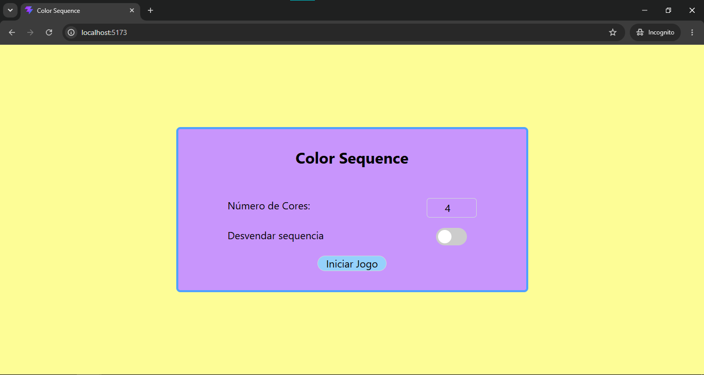

# Color Sequence

## O que é?

O Colors Sequence é uma aplicação onde o usuário deve adivinhar uma determinada a sequência de cores gerada, sabendo somente a quantidade de cores certas e a quantidade de posições das cores corretas.

## Objetivo

O objetivo deste projeto é matar a curiosidade e aprender mais sobre React e Tailwind CSS, praticar a construção de componentes e entender como montar uma interface estilizada usando a biblioteca Tailwind. Além disso, é a vontade de criar algo próprio e resolver um desafio de lógica.

## Tecnologias


  [](#)
  [](#)
  [](#)


## Funcionalidades

- Exibição responsiva com estilo moderno
- Geração de sequências de cores randomicamente
- Interação Drag-Drop básica para testar diferentes combinações
- Verificação da Sequência e retornando o resultado
- Contador de tentivas 
- Código para desvendar sequência gerada
- Formulário de Menu para personalizar a sequência:
  - adicionar/remover cores
  - aumentar/diminuir o tamanho da sequência
  - ativar/desativar Desvendar Sequência


## Como executar?
Têm duas opções

### Site
Acesse o link no seu navegador preferido

### Localmente

1. Clone o repositório e baixe as dependências
``` bash
  git clone https://github.com/devDavyRibeiro/colors-sequence.git
```
``` bash
  npm install
```

2. Execute o comando para iniciar a aplicação

``` bash
  npm run dev
```

3. Acesse pelo navegador em http://localhost:5173/

## Observações
Esta é a primeira vez que usei o React (ainda mais com TS) e o Tailwind CSS. Então se houver alguma coisa que não é recomendado, ou boa prática, ou alguma melhoria que queira sugir, pode conversar comigo que ouvirei com todo o prazer 😁